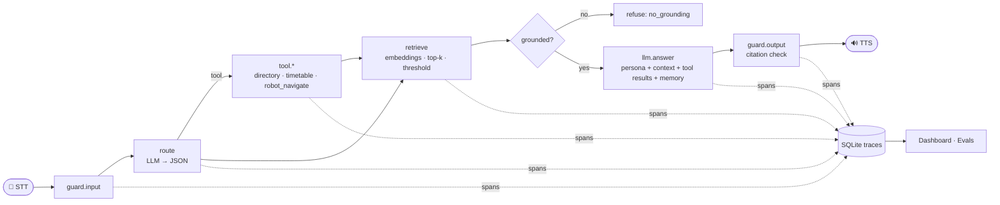

# Ari: from API wrapper to observable agent

**Ari** is the AI assistant robot of EMINES – School of Industrial Management (UM6P). It stands in the
entrance hall, answers questions about the school, reads the timetable, and physically guides visitors.

This repository rebuilds Ari's brain the way companies take an LLM to production: **seven stages, each
adding exactly one layer**, from a bare API call to an agent whose every decision is traced, measured
and evaluated. Pick any stage in the UI, ask the same question, and see what that layer buys.

> **Origin.** The original Ari was built at EMINES by a cross-functional team of 11 (LangChain, a locally
> hosted Llama, speech-to-text / text-to-speech, AstraDB retrieval). It was built, not deployed. This repo
> is my end-to-end rebuild of its conversational stack, structured as a production ladder. The campus
> data in `knowledge/` is **sample data**, to be replaced with official documents.

## The ladder

| Stage | Adds | What goes wrong without it |
|---|---|---|
| **v0** API wrapper | A raw call to the model | Knows nothing about EMINES; answers like a generic chatbot |
| **v1** Persona | System prompt: identity, audience, spoken style, language rules | Sounds right, **invents facts** ([real example](docs/sample_ladder_gemma3-4b.md)) |
| **v2** Grounded (RAG) | Retrieval over school documents, numbered citations, "I don't know" rule | Can't act or read live data |
| **v3** Tools (agent) | JSON router → campus directory, timetable, **robot navigation**, clock, calculator | Forgets the previous turn |
| **v4** Memory | Sliding window of recent turns per session | Obeys prompt injections, guesses when nothing is retrieved |
| **v5** Guardrails | Injection and length checks, refusal when nothing is grounded, citation validation, restricted-area safety | Runs blind: no way to know *why* an answer was wrong or slow |
| **v6** Observable | Span-level traces in SQLite, latency/token/refusal metrics, 👍/👎 feedback, live dashboard, PII redaction in logs | n/a |

Every stage is the same pipeline (`ari/agent.py`) with feature flags switched on (`ari/stages.py`), so
the difference between two stages is exactly one layer.



## Quick start

Inference is **remote by default**: chat on Groq (`llama-3.3-70b-versatile`), embeddings on Gemini
(`gemini-embedding-001`). Your machine only runs a small Python web server. Both have free tiers
with no card required.

```bash
pip install -r requirements-dev.txt
cp .env.example .env
```

Fill in the two keys in `.env`:
- `GROQ_API_KEY`: [console.groq.com/keys](https://console.groq.com/keys)
- `GEMINI_API_KEY`: [aistudio.google.com/apikey](https://aistudio.google.com/apikey)

Then, once, calibrate the retrieval threshold for your embedding model, and start Ari:
```bash
python -m ari calibrate      # relevant vs off-topic scores -> suggested ARI_MIN_SCORE for .env
python -m ari serve          # http://127.0.0.1:8000
```

> On the Gemini free tier, Google may use prompts to improve its products. That's acceptable here
> because Ari's knowledge base is sample data; use a paid tier for real student conversations.

**Docker:** `docker compose up --build` reads the same `.env` (only the `ari` web service runs).

**No keys yet?** The deterministic mock provider runs the whole pipeline offline, with no model:
```bash
python -m ari --provider mock serve
```

**Other providers** (set in `.env`, same variables):

| `ARI_PROVIDER` | Use |
|---|---|
| `groq` (default) | Groq chat; embeddings default to `ARI_EMBED_PROVIDER=gemini` |
| `gemini` | Chat on Gemini too (`ARI_MODEL=gemini-2.5-flash`): one key for everything |
| `openai` | Any OpenAI-compatible endpoint: set `ARI_BASE_URL` and `ARI_API_KEY` |
| `ollama` | A self-hosted Ollama on a separate server: set `ARI_BASE_URL` |
| `mock` | Offline rule-based stand-in used by the tests and CI |

HTTP 429 and 5xx responses are retried with the server's `Retry-After` header or exponential backoff,
so free-tier rate limits slow an eval run down instead of failing it.

### Other commands
```bash
python -m ari chat --stage v6                              # terminal chat with trace ids
python -m ari ladder "What are the library opening hours?" # same question, all 7 stages
python -m ari eval --stages v0,v2,v6                       # eval suite -> evals/reports/
python -m ari calibrate                                    # retrieval threshold for your embedder
python -m ari voice                                        # mic -> Whisper -> Ari -> TTS
python -m pytest -q                                        # 15 offline tests
```

## Observability (v6)

Each request is a trace; each step is a span with its duration and what it saw and decided:

| Span | Attributes recorded |
|---|---|
| `guard.input` | allowed, refusal reason |
| `route` / `llm.route` | router JSON (raw and parsed), tokens |
| `tool.<name>` | arguments, result, error status |
| `retrieve` | query, every candidate chunk with its score, how many passed the threshold |
| `llm.answer` | model, prompt and completion tokens |
| `guard.output` | invalid citations removed, uncited answer flag |

The dashboard aggregates p50/p95 latency per step, refusal reasons, tool-call rate, token usage and
the 👍 rate. Inputs, outputs and attributes are **PII-redacted before storage** (e-mails, phone numbers).
The schema maps one-to-one onto OpenTelemetry spans, so it can be exported to Langfuse, Phoenix or Jaeger.

**Why it matters, concretely:** when Ari says something wrong, the trace tells you which layer failed.
Was the right chunk retrieved, and with what score? Did the router pick the wrong tool? Did the model
ignore the context? Each of those has a different fix (documents, router prompt, or model).

## Evals

`evals/dataset.jsonl` has 24 cases in five categories: **grounded** facts (13, including one in French),
**tool** routing (4), robot **safety** (1), **refuse** (4: two prompt injections, one off-topic and one
on-topic question the documents can't answer) and multi-turn **memory** (2). `python -m ari eval` runs
every case against every stage and writes a Markdown report with pass rates per category, citation rate
and latency. Failures at the top stage are listed with their **trace id**, so each one can be opened in
the dashboard.

Offline (mock provider), the ladder goes from **21% (v0) to 92% (v6)**; CI runs this on every push.
Mock numbers only prove the plumbing. Run the suite with your real model to get the numbers that matter.

## Design decisions

- **Remote inference, swappable providers.** Groq for chat, Gemini for embeddings by default, behind
  one small interface (`ari/llm.py`, stdlib HTTP only). The original Ari ran a local Llama; pointing
  `ARI_PROVIDER=ollama` at a self-hosted server on campus restores that setup, so no conversation
  leaves the school network.
- **Prompt-based JSON routing** instead of native function calling. A constrained JSON reply works the
  same on every provider, including small models that handle tool-calling APIs poorly.
- **Two-layer grounding.** A similarity threshold alone can't separate "on-topic but unanswerable" from
  "answerable" (see [calibration](docs/sample_ladder_gemma3-4b.md#retrieval-calibration-nomic-embed-text-v15)),
  so v5 combines it with a grounding instruction plus output citation checks. The threshold is set per
  embedding model: 0.55 measured for nomic, 0.65 provisional for Gemini until `ari calibrate` is run.
- **No framework in the core.** The original Ari used LangChain. Here each layer is about 50 lines of
  plain Python, so the ladder stays readable. `VectorStore` is the single class to swap for AstraDB.
- **Robot safety lives in the tool, not the prompt.** `robot_navigate` refuses restricted or
  non-reachable places in code, whatever the model asks for. `SimulatedRobot` logs commands; on the real
  robot, implement `RobotInterface.navigate` with a ROS 2 Nav2 goal.

## Project structure

```
ari/
  stages.py      the ladder: 7 cumulative feature-flag configs
  agent.py       the pipeline (guard → route/tools → retrieve → answer → guard → memory)
  llm.py         Groq, Gemini, OpenAI-compatible, Ollama and mock providers, retry/backoff (stdlib HTTP)
  rag.py         chunking, API/hashing embedders, per-model thresholds, NumPy vector store with cache
  tools.py       campus directory, timetable, robot navigation, clock, safe calculator
  guardrails.py  injection/length checks, scope refusal, citation validation, PII redaction
  memory.py      per-session sliding window
  tracing.py     spans → SQLite, metrics aggregation
  evals.py       eval runner and Markdown report
  server.py      FastAPI: /api/chat, /api/traces, /api/metrics, /api/feedback
  voice.py       optional Whisper STT + pyttsx3 TTS loop
  static/        web console (chat + trace waterfall + dashboard), no build step
knowledge/       sample EMINES documents and campus/timetable JSON
evals/           dataset.jsonl (+ generated reports/)
docs/            real-model sample run and retrieval calibration
tests/           offline pytest suite (mock provider)
```

## Roadmap

- Export spans over OTLP to Langfuse/Phoenix; add prompt versions to the trace
- LLM-as-judge faithfulness scoring alongside keyword checks
- ROS 2 `RobotInterface` implementation and a wake word for the voice loop
- Query rewriting for follow-ups instead of concatenating the previous question

Built with Claude Code.
