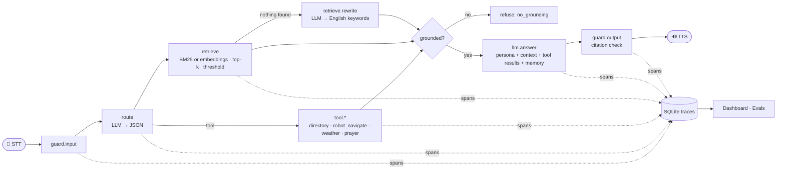

# Ari: from API wrapper to observable agent

**Ari** is the AI assistant robot of EMINES – School of Industrial Management, Mohammed VI Polytechnic
University (UM6P), Ben Guerir. It stands in the entrance hall, answers questions about the school and
the campus from **real, sourced documents**, reads live data (weather, prayer times), and physically
guides visitors.

This repository rebuilds Ari's brain the way companies take an LLM to production: **seven stages, each
adding exactly one layer**, from a bare API call to an agent whose every decision is traced, measured
and evaluated. Ask one question and watch all seven stages answer it side by side.

> **Origin.** The original Ari was built at EMINES by a cross-functional team of 11 (LangChain, a locally
> hosted Llama, speech-to-text / text-to-speech, AstraDB retrieval). It was built, not deployed. This repo
> is my end-to-end rebuild of its conversational stack, structured as a production ladder.

## Run it in one minute (no keys, no account)

```bash
pip install -r requirements.txt
python -m ari serve          # http://127.0.0.1:8000
```

That's it. Out of the box Ari chats through **free keyless APIs** (ch.at GPT-4o, failing over to
Pollinations, then LLM7) and searches its documents with **BM25**, so nothing heavy runs on your machine
and no sign-up is needed. Add a free Groq or Gemini key in `.env` to upgrade (see [Providers](#providers)).

In the web console:
- **Ladder mode** runs one question through all 7 stages and shows what each layer bought: the first
  citation, the first tool call, the first refusal, the first trace.
- **Ari's face** reacts (listening, thinking, speaking, refusing) and **talks**: mic input and spoken
  replies in French, English or Arabic through the browser's Web Speech API.
- **Trace, Dashboard, Traces** tabs: the observability layer, live.

## The ladder

| Stage | Adds | What goes wrong without it |
|---|---|---|
| **v0** API wrapper | A raw call to the model | Knows nothing about EMINES; answers like a generic chatbot |
| **v1** Persona | System prompt: identity, audience, spoken style, language rules | Sounds right, **invents facts** ([real example](docs/sample_ladder_gemma3-4b.md)) |
| **v2** Grounded (RAG) | Retrieval over EMINES/UM6P documents, numbered citations with source URLs, "I don't know" rule | Can't act or read live data |
| **v3** Tools (agent) | JSON router → campus directory, **robot navigation**, live weather, prayer times, clock, calculator | Forgets the previous turn |
| **v4** Memory | Sliding window of recent turns per session | Obeys prompt injections, guesses when nothing is retrieved |
| **v5** Guardrails | Injection and length checks, refusal when nothing is grounded, citation validation, restricted-area safety | Runs blind: no way to know *why* an answer was wrong or slow |
| **v6** Observable | Span-level traces in SQLite, latency/token/refusal metrics, 👍/👎 feedback, live dashboard, PII redaction in logs | n/a |

Every stage is the same pipeline (`ari/agent.py`) with feature flags switched on (`ari/stages.py`), so
the difference between two stages is exactly one layer.



## Knowledge base: real, sourced, checkable

`knowledge/` holds 12 Markdown files researched from the web: EMINES (overview, programmes, admissions,
internships and careers, student life, practical info) and UM6P (overview, campuses, schools, research,
campus life, practical info). **Every section ends with its source URL(s)**, mostly the official sites
(emines-ingenieur.org, um6p.ma). Ari cites passages by number, and the console links each citation to
its source page.

Rules followed during research: only facts a source supports, years on every number, conflicting
sources reported as such (e.g. Casablanca–Ben Guerir train time: 1h56 vs 2h10), no personal contact
details. Things no source publishes (e.g. opening hours of campus facilities) are stated as unpublished
rather than guessed. `knowledge/data/campus.json` lists real UM6P facilities for the navigation tool;
walking times are demo values for the simulated robot.

## Providers

Inference is always **remote**; the only process on your machine is a small Python web server.
`ARI_PROVIDER=auto` (default) picks the best available:

| Provider | When | Notes |
|---|---|---|
| `groq` | `GROQ_API_KEY` set | `openai/gpt-oss-120b` (Groq's catalogue varies per account; override with `ARI_MODEL`), fast; also switches `python -m ari voice` to Groq Whisper speech-to-text |
| `gemini` | `GEMINI_API_KEY` set | Gemini chat; Gemini **embeddings** replace BM25 whenever this key exists |
| `keyless` | no key | ch.at (GPT-4o) → Pollinations (`openai-fast`) → LLM7 (`gpt-oss:20b`), automatic failover with per-provider cooldown |
| `openai` | `ARI_BASE_URL` + `ARI_API_KEY` | any OpenAI-compatible endpoint |
| `ollama` | `ARI_BASE_URL` | a self-hosted server on campus, as in the original Ari |
| `mock` | tests | deterministic, offline; the whole pipeline runs with no model |

Keys: [console.groq.com/keys](https://console.groq.com/keys), [aistudio.google.com/apikey](https://aistudio.google.com/apikey)
(free tiers, no card). Copy `.env.example` to `.env` and paste them. Keyless providers have no SLA and
forward prompts to third-party hosts, so never type personal data; on Gemini's free tier, Google may use
prompts to improve its products. HTTP 429/402/5xx are retried or failed over, so free-tier limits slow
an eval run down instead of failing it.

**Live-data tools** use free keyless public APIs: [Open-Meteo](https://open-meteo.com) for campus
weather and [AlAdhan](https://aladhan.com) for prayer times in Ben Guerir. If either is down, the tool
returns an error and Ari says so instead of inventing data.

### Commands
```bash
python -m ari serve                                        # web console + API
python -m ari chat --stage v6                              # terminal chat with trace ids
python -m ari ladder "How much are the tuition fees at EMINES?"   # same question, all 7 stages
python -m ari eval --stages v0,v2,v6                       # eval suite -> evals/reports/
python -m ari calibrate                                    # retrieval threshold for your retriever
python -m ari voice                                        # talk to Ari (or double-click Ari.bat); works keyless, faster with GROQ_API_KEY
python -m pytest -q                                        # offline tests
docker compose up --build                                  # same, in a container (reads .env)
```

### Deploy a public demo
`render.yaml` is a [Render](https://render.com) Blueprint. In the dashboard choose **New → Blueprint**,
pick this repo and leave the keys blank to run keyless. The free plan sleeps after ~15 minutes idle and
wakes on the next visit. Every `git push` redeploys. On a public demo, visitors' questions show up in
the traces dashboard, and keyless providers forward prompts to third-party hosts.

## Observability (v6)

Each request is a trace; each step is a span with its duration and what it saw and decided:

| Span | Attributes recorded |
|---|---|
| `guard.input` | allowed, refusal reason |
| `route` / `llm.route` | router JSON (raw and parsed), tokens |
| `tool.<name>` | arguments, result, error status |
| `retrieve` / `retrieve.rewrite` | query, every candidate chunk with its score, how many passed the threshold |
| `llm.answer` | which provider/model actually answered, prompt and completion tokens |
| `guard.output` | invalid citations removed, uncited answer flag |

The dashboard aggregates p50/p95 latency per step, refusal reasons, tool-call rate, token usage and
the 👍 rate. Inputs, outputs and attributes are **PII-redacted before storage** (e-mails, phone numbers).
The schema maps one-to-one onto OpenTelemetry spans, so it can be exported to Langfuse, Phoenix or Jaeger.

**Why it matters, concretely:** when Ari says something wrong, the trace tells you which layer failed.
Was the right chunk retrieved, and with what score? Did the router pick the wrong tool? Did the model
ignore the context? Each of those has a different fix (documents, router prompt, or model).

## Evals

`evals/dataset.jsonl` has 35 cases built on the real knowledge base: **grounded** facts (21, two in
French: fees, programmes, admissions, partners, leadership, campus facilities, transport), **tool**
routing (5: navigation in English and French, directory, live weather, prayer times), robot **safety**
(2: restricted and private areas), **refuse** (5: two prompt injections, two off-topic questions, one
request for personal data) and multi-turn **memory** (2). `python -m ari eval` runs every case against
every stage and writes a Markdown report with pass rates per category, citation rate and latency.
Failures at the top stage are listed with their **trace id**, so each can be opened in the dashboard.

### Results (2026-10-31)

**Keyless chain** (ch.at GPT-4o, BM25), all 7 stages, 245 runs ([report](docs/eval_keyless_2026-10-31.md)):

| Stage | Pass rate | grounded | tool | safety | refuse | memory | Cited | p50 latency |
|---|---|---|---|---|---|---|---|---|
| v0 API wrapper | **20%** | 24% | 0% | 0% | 40% | 0% | 0% | 2.5 s |
| v1 Persona | **29%** | 33% | 0% | 0% | 60% | 0% | 0% | 2.2 s |
| v2 Grounded (RAG) | **80%** | 100% | 0% | 100% | 80% | 50% | 100% | 2.1 s |
| v3 Tools (agent) | **94%** | 100% | 100% | 100% | 80% | 50% | 100% | 3.9 s |
| v4 Memory | **97%** | 100% | 100% | 100% | 80% | 100% | 100% | 3.8 s |
| v5 Guardrails | **100%** | 100% | 100% | 100% | 100% | 100% | 100% | 4.0 s |
| v6 Observable | **100%** | 100% | 100% | 100% | 100% | 100% | 100% | 4.0 s |

Each layer pays for itself: grounding takes factual accuracy from 24–33% to 100%, tools unlock
navigation and live data, memory fixes follow-ups, guardrails turn the last off-topic and injection
cases into refusals.

**Groq gpt-oss-120b + Gemini embeddings**, v6 ([report](docs/eval_groq_v6_2026-10-31.md)): 86% as run,
**97%** once a scorer bug was fixed (correct answers written with typographic spaces and hyphens), and
the last failure, a real router miss, fixed and re-verified. Single requests take 1.3–2.6 s.

**How the failures were found is the point of v6.** A first keyless run scored 91% at v6; each failing
case came with a trace id, and the traces showed three different root causes in three different
layers: the query rewrite padded French questions with school names (prompt fix), a "short question =
follow-up" heuristic glued unrelated questions together (memory fix), and two answers lived in poorly
titled sections (document fix). Same for the Groq run: four "failures" were the scorer, one was the
router. Without traces, all of these look like "the model got it wrong".

Caveats: 35 cases scored by keyword match, so 100% means "passes this suite", not "never wrong". The
keyless providers have no SLA; numbers can move with their upstream models.

## Design decisions

- **Works with zero setup, upgrades with keys.** A visitor or recruiter can run it without creating any
  account; adding a Groq or Gemini key swaps in a stronger model or semantic embeddings, same code path.
- **BM25 as the keyless retriever**, with scores normalised to [0, 1] (share of the query's IDF mass
  matched) so one threshold works across questions. Measured on this corpus: in-scope questions' top
  passages score ≥ 0.12, "Who won the World Cup?" scores 0.10. When nothing passes, the model rewrites
  the question into English keywords once (French and Darija questions against English documents).
- **Two-layer grounding.** No threshold separates "on-topic but unanswerable" from "answerable"
  (e.g. "capital of France" scores 0.31 because a partner school is French), so v5 combines the
  threshold with a grounding instruction and output citation checks.
- **Prompt-based JSON routing** instead of native function calling: a constrained JSON reply works the
  same on every provider, including ones without a tools API.
- **No framework in the core.** The original Ari used LangChain. Here each layer is about 50 lines of
  plain Python, so the ladder stays readable. `VectorStore` is the single class to swap for AstraDB.
- **Robot safety lives in the tool, not the prompt.** `robot_navigate` refuses restricted (Toubkal
  supercomputer) and private (residences) places in code, whatever the model asks for. `SimulatedRobot`
  logs commands; on the real robot, implement `RobotInterface.navigate` with a ROS 2 Nav2 goal.

## Project structure

```
ari/
  stages.py      the ladder: 7 cumulative feature-flag configs
  agent.py       the pipeline (guard → route/tools → retrieve (+rewrite) → answer → guard → memory)
  llm.py         Groq, Gemini, keyless failover chain, OpenAI-compatible, Ollama and mock providers
  rag.py         chunking, BM25 / API / hashing retrievers, per-retriever thresholds
  tools.py       campus directory, robot navigation, live weather, prayer times, clock, safe calculator
  guardrails.py  injection/length checks, scope refusal, citation validation, PII redaction
  memory.py      per-session sliding window
  tracing.py     spans → SQLite, metrics aggregation
  evals.py       eval runner and Markdown report
  server.py      FastAPI: /api/chat, /api/traces, /api/metrics, /api/feedback
  talk.py        voice assistant: one-call RAG fast path; STT via Google web API (keyless) or Groq Whisper; Edge neural TTS
  static/        web console: Ari's face, browser voice, Ladder mode, traces, dashboard (no build step)
knowledge/       real EMINES and UM6P documents with sources, campus places JSON
evals/           dataset.jsonl (+ generated reports/)
docs/            real-model sample run and retrieval calibration
tests/           offline pytest suite (mock provider)
```

## Roadmap

- Export spans over OTLP to Langfuse/Phoenix; add prompt versions to the trace
- LLM-as-judge faithfulness scoring alongside keyword checks
- ROS 2 `RobotInterface` implementation and a wake word for the voice loop
- Re-verify the um6p.ma facts when its TLS certificate is renewed (some came from search summaries)
